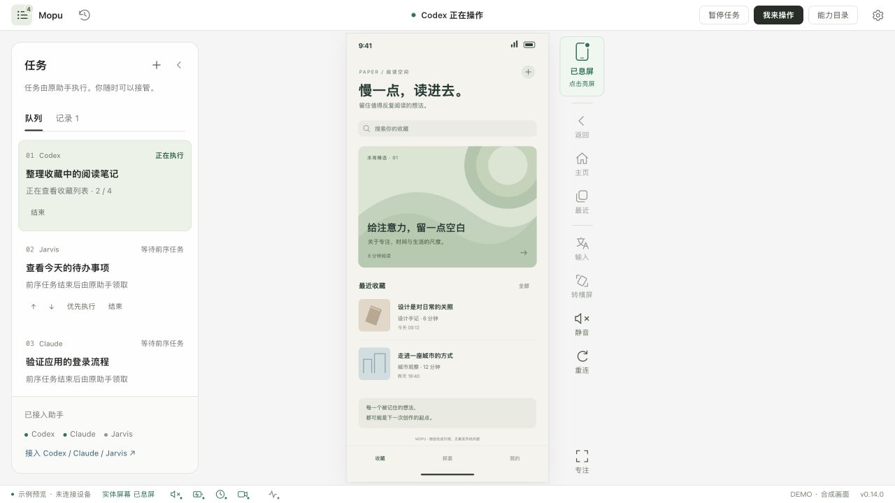

# Mopu：把手机交给你正在使用的助手

原名 Phone Harness，现统一命名为 Mopu（莫普）。[迁移与兼容说明](docs/migration-mopu.md)。

[English](README.md) · [预览版下载](https://github.com/maxi-max-dev/mopu/releases) · [反馈问题](https://github.com/maxi-max-dev/mopu/issues/new/choose)

**MIT 开源预览版。** 当前只建立了限定设备与能力的验证，尚不是全面兼容或长期无人值守的保证。

你给 Codex、Claude Code 或 Jarvis 的任务，仍由那个助手完成。Mopu 提供真机画面、操作工具、任务队列和人工接管；你可以随时点「我来操作」，用完再「交回助手」。手机连接时默认息屏和静音，电脑窗口显示实时画面；需要给身边的人看时，也可以主动亮屏。

macOS 有独立软件窗口，不需要浏览器标签页。浏览器入口仍保留给 Linux 或偏好网页的使用者。当前是 0.19.1 公开预览版：已验一台 Android 真机，尚不支持 Windows，也未证明所有品牌手机兼容。

手机始终对齐整个窗口的中线，任务面板展开不会把它推偏。左侧看任务与进度，右侧工具跟随画面边缘；窗口不够宽时，任务面板临时覆盖显示并阻止下方手机误触。顶部始终保留接管入口，专注模式可进一步放大画面。




*图中手机内容与任务均为示例，不是私人手机截图。界面采用石墨灰、轻量工具条和清晰的控制权交接。*

## 第一次安装

先安装 Python 3.11+、Node.js/npm、Android platform-tools 的 adb。使用各项目官方来源；安装程序不会替你更改这些主机环境。macOS 独立窗口还需要 Apple Command Line Tools。

解压源码，进入目录，连接 USB 手机。解锁手机、开启 USB 调试，并在手机上允许这台电脑。

```sh
git clone https://github.com/maxi-max-dev/mopu.git
cd mopu
python3 -m venv .venv
.venv/bin/pip install .
.venv/bin/mopu setup --install-dependencies
.venv/bin/mopu doctor
.venv/bin/mopu install-app
```

然后在你的 Applications 目录打开 **Mopu**，点「连接手机」。Linux 或只想用网页时执行 `.venv/bin/mopu open`。

安装会固定绑定当前唯一已授权的 USB 手机，下载经过 SHA-256 校验的 scrcpy 5.0.1 服务端，并安装 Mobile MCP 1.0.9。多个设备同时接入时必须用 `setup --serial 目标序列号` 指定。已有配置会保留，不会覆盖。全新安装的设备配置与任务记录放在 `~/.local/share/mopu`；已有 `~/.local/share/phone-harness` 时自动复用旧目录，不放在源码里。

## 接入 Jarvis / OpenClaw

```sh
python3 integrations/openclaw/install.py --agent main --name Jarvis
openclaw config validate
```

安装器备份原配置，只增加手机工具，保留现有模型和其他权限。如果宿主没有自动加载插件，在没有任务运行时重启 OpenClaw。随后向 Jarvis 原对话说你要它在手机上做什么。手机任务应明确目标、完成条件和禁止动作。

例如：「从手机系统设置读取存储余量和 Android 版本，不改设置。请使用 Mopu，把两项检查排队执行。」

新任务使用 `phone_start` 记录一次整任务授权，在空闲手机上自动取得任务控制入口；旧的 `phone_submit` 排队方式仍需「交回助手」。中途点「我来操作」就暂停助手读屏和输入；交回后，它先重新观察，再根据已保存进度继续。即使之前那轮 Jarvis 回复已结束，适配器也会续接同一个原对话；电脑和 OpenClaw 必须仍在运行。它不会恢复其他巡检，不会自动向聊天渠道发送结果。

## 接入 Codex / Claude Code

使用 [README 的 MCP 配置示例](README.md#connect-an-assistant)，命令指向 `.venv/bin/mopu`，参数为 `mcp --agent 唯一身份 --name 显示名称`；并安装 `skills/mopu/SKILL.md`。同时运行的不同对话应配置不同身份。

Codex / Claude Code 需要原对话仍在执行，或者由你在原对话要求继续。这里只对 OpenClaw 实现了结束回复后的自动续接。

## 一次授权，持续完成任务

支持标准 MCP，也支持 `mopu call --agent 唯一对话身份 工具名 --json @参数.json`，无需为每个模型另写守护进程。调用方仍须具备 MCP 或本机／远程 Shell 执行能力。

新任务用 `phone_start` 声明用户授权、总调用额度、发送上限和有效期，再 `phone_wait` 领取租约。额度覆盖整个任务，不再每 200 次调用要求点击续批；心跳与工具目录读取不扣额度。人工接管、暂停、断线或服务重启会停止授权。旧任务不会自动迁移或恢复。

每次发送保留稳定目标标识与读回证据；不确定结果保持待核验并阻止后续输入。界面区分已核验、待核验、未发送与旧记录未知，助手自报数量不冒充送达记录。详见 [AI 接入说明](docs/AI_CLIENTS.md)。

## 日常操作

- 操作位置提示默认开启：助手点击显示淡紫色圆环，手动点击显示暖黄色圆环；滑动显示轨迹和方向箭头，顶部短暂显示动作名称。松开后手动圆环约 0.45 秒、助手圆环约 0.9 秒淡出；下一次操作出现时，上一处在 0.12 秒内消退，始终突出最新位置，可在「会话设置」选择标准、醒目、更大或关闭。提示只显示在电脑窗口，不改手机的开发者触点设置，也不展示输入的具体文字。
- 提示区分「已发送」「待画面核验」和「结果未确认」；是否达到任务目标仍需看手机实际画面。暂停接管、旋转或断线会清除旧提示，旧动作不会作为新动作重播。

- 「我来操作」：停止助手后续读屏和输入。已经发给手机的一个动作可能完成，界面会等待它结束后交接。
- 「交回助手」：由任务所属的原助手重新观察并继续。
- ↑ / ↓：调整等待顺序；「优先执行」还会暂停当前任务并保留进度。
- 「结束」：停止该任务，保留历史和已保存结果。
- 右上角的实体屏幕按钮：绿色「已息屏」可点亮，橙色「已亮屏」可按灭；按灭后电脑投屏继续。灰色「待确认」表示状态未知，点击会明确请求息屏。
- 指示灯读取手机系统的实体面板状态，约每 1.5 秒更新，界面每秒同步；正常连接下通常几秒内发现变化。读数超过 5 秒或连接断开时不再显示已息屏。它不是外部摄像头，也无法保证捕获短于轮询间隔的闪亮。
- 左侧任务栏默认收起，点「任务」「记录」展开；没有待执行任务时底部任务条隐藏。手机画面按可用高度／宽度完整放大，窗口大小改变后自动适配。
- 「转横屏／转竖屏」改变真实手机方向，画面和点击坐标随之更新；先接管手机才能旋转。部分锁屏或应用固定方向时会提示仍保持原方向。
- 底栏的小图标分别打开静音细项、充电与电池、最后核验时间、摄像头、麦克风与闪光灯详情；不占额外手机画面宽度。右侧「静音」也打开细项，里面可一键恢复。
- 静音分别读回媒体、铃声、通知、闹钟、触摸/拨号音和通话通道。空闲时通过系统音频命令降低并静音电话与蓝牙通话；通话进行中不改变通话通道。每次以读回为准，未知或仍有音量会显示出来。接通和切换输出可能改变状态，尚未证明真实通话全过程无声。
- 摄像头、麦克风、系统录屏或通话音频被检测到正在使用时出现提示条；结束后清除。约 2 秒采样，可能漏掉极短使用，部分系统采音和底层投屏不在覆盖范围。只取活动状态，不录制画面或声音。
- 后置手电筒通过 SystemUI 的当前 TorchCallback 状态读回，亮灯时提示，点开设备活动图标可看关闭、开启或未知及核验时间。接口不可用、读数失败或过期时显示未知。此项不覆盖相机拍照瞬时闪光、相机自行控制的补光或前置屏幕补光；不主动点亮、不自动关闭。
- 电池详情区分“已接电”“正在充电”和“充电保护暂停”；AC/USB 类型按手机系统报告，不能仅从 USB 数据连接推断正在充电。核验时间来自各项实际读取，失效后变灰。
- 「重连」不会重放输入或自动继续操作。
- 设置里的「关闭控制台后暂停」默认开启。关闭后仍保留任务；需要无人观看时继续执行，可以明确关闭此选项。

手机实体息屏、Android 自动息屏时间、逻辑休眠与屏幕锁定是不同状态。连接瞬间可能短亮。系统静音读回不等于所有第三方应用与紧急提示都已做声学验收。温度显示的是电池温度。

## 排错和反馈

运行 `.venv/bin/mopu doctor`；它只检查依赖和 USB 授权。离线或未授权通常需要解锁、允许调试或检查线缆。不要同时用另一套 ADB/镜像控制器争抢手机。

提交反馈时使用 `.github/ISSUE_TEMPLATE` 中的模板，说明系统、Android 版本、任务目标、在哪一步停住、接管是否生效。不要附上原始配置、设备序列号、访问令牌或未经检查的手机截图。当前没有自动反馈上传。

完整验收与尚未覆盖项见 [VALIDATION.md](VALIDATION.md)。本版补充验收见 [0.19.1 验收说明](docs/VALIDATION-0.19.1.md)，不代表其他人的手机已经通过验收。

## 参与改进

用 `python3 tools/preview.py` 可在不连接手机的情况下预览真实前端与合成数据。详见 [贡献说明](CONTRIBUTING.md)、[安全边界](SECURITY.md)、[设计思路](docs/DESIGN.md) 和 [第三方许可](THIRD_PARTY.md)。

## 手机活动记录（0.8 本地预览）

底栏波形小图标打开活动时间线，按人工、助手和待核实的设备输入分类；连续操作合并，飞书提醒设 10 秒合并窗口与 5 分钟冷却。正式外部操作告警要求真机实体输入对照通过。当前 G100 仅完成远程输入负向对照和单条飞书测试，实体触摸仍待验。配置与检测边界见 [活动记录说明](docs/ACTIVITY.md)。

0.8.1 本地预览新增 **App 停留**：应用名称/包名、起止观察时间、前台约多久、期间记录的输入次数。不保存页面内容；锁屏、读数中断或断线即停止计时。前台停留不等于持续使用，也不能据此确认操作者。

## 本地 0.9.0：完成回执、等待原因、能力目录

完成回执逐项显示验收条件、实际读回、观察时间和未解决项。助手在最后一次输入后重新观察，将工具返回的 `phone_harness_observation.id` 交给 `phone_finish.checks`。服务验证来源属于当前任务/控制权、未超过 120 秒、晚于最近输入；语义是否符合要求仍由原助手判断。只有非空且全部通过、无未解决项的回执进入已核验完成。只有结果文字的旧客户端保留为“结果待核验”；旧历史不改写。

`phone_checkpoint.wait_reason` 支持 `user_unlock`、`user_decision`、`external_service`，同时写清 `next_action`。普通滑动锁屏可在任务授权内尝试；不能把锁屏遥测直接当成需要密码。明确等待后停止自动重领，处理后交回或重试同一任务，保留原回执。

右上角“能力目录”展示当前 14 项允许工具，区分直接能力与界面操作；`phone_tools` 才确认本次设备后端实际提供哪些工具。目录不是 OEM 系统权限，也不保证所有 App 都可自动完成。原助手负责观察、执行和验收；控制台不启动模型。

新 MCP 进程会读取新 schema；已经运行的宿主需按其重载方式更新连接。本节记录 0.9.0 的新增能力。当前版本为 0.19.1，历史 release 保留。

## 0.10.0：实机多 App 任务与单步读回（2026-10-18）

新增 `phone_step`：验证当前屏幕观察与租约、保存检查点、执行一个动作并返回新文字或截图。`expected_text` 只是文字匹配，不代表任务完成；读回失败不自动重放。文字输入改用现有控制台 scrcpy 剪贴板粘贴通道，输入与提交分离。

实机完成：计算器128×3+76=460；Moto笔记保存计算结果并重开核对；Chrome从example.com进入IANA说明页并阅读。高德停在首次协议，路线查询未完成。升级后中文标题直接写入，退出重开仍保存。121项Python、18项JavaScript检查通过。自定义编辑器/WebView仍需截图；队列不启动模型；OpenClaw适配文件已更新但网关未重启验证。

## 0.11.0：跨 App 阶段验收（2026-10-18）

提交时可声明 `required_milestones`；`phone_milestone` 在切换 App 前封存新鲜的阶段读回。阶段 key 不可覆盖，历史观察不会冒充当前状态；最终完成仍必须有新鲜读回，缺必需阶段则待核验。控制台详情展示阶段；中断续接保留，重试保留旧尝试并重置本次阶段。`phone_step` 可用 `read_attempts=1..3` 等待预期文字，仅重复读取，不重放输入。

真机完成：旧预算笔记→计算器→原笔记修订529元；Chrome官方说明→中文摘要笔记→重开；设置实时256GB/39GB→计算器217→中断续接→存储笔记重开。后两条使用0.11阶段约束。130项Python、18项JS通过；本机安装运行。OpenClaw文件更新但网关未重启，不宣称活跃Jarvis加载。仅3个有界任务样本，不是所有App稳定性或成功率证明。

## 0.12：点击前重新定位与购物闭环

`phone_step` 可传 `target`（精确 id/text/label，可附 type），不用同时传坐标。执行层在同一控制租约和操作锁内重读屏幕，目标唯一且可用才点一次；目标消失、重名或不可用时返回新观察及 `action_dispatched:false`，不猜旧坐标。自定义画布仍需截图，点击成功仍需读回；前置读取与实际点击不是原子操作。

真机完成两类购物场景各三轮：两店同款比价→本地日历跟进；官方说明书→下载→超级文件重开。重复执行复用已有结果。具体范围与剩余限制见 VALIDATION.md。

## 0.13.0 shopping acceptance (2026-10-18)

`phone_step` adds bounded `settle_ms=400..5000` before the first readback (default400) for observed lazy-loaded screens. It never repeats input; takeover is rechecked before reading. Waiting is not a readiness assertion. Shopping skill guidance now separates SKU, promotion eligibility/stacking, display currency and unknown delivery fees.

Physical G100: three repeated Xiaohongshu F63 white/quantity1 checks sealed SKU, coupon and shipping stages; all agreed on CNY399−71=328 (approximately AUD71.33), black sold out. Cross-border freight remains unknown, so all three final receipts are unverified. No coupon claim, cart addition, checkout, order or payment. Twelve 3000ms screenshot readbacks (two SKU, ten detail swipes) were inspected; cache/network were uncontrolled, not a general reliability rate. 142 Python and18 JavaScript tests passed;22 installed runtime files match source. Local0.13 only; public release unchanged; OpenClaw files copied without gateway restart.
